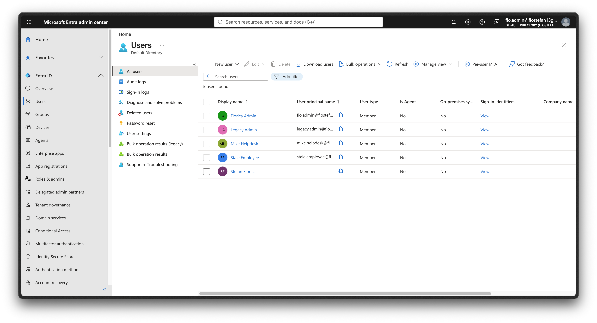
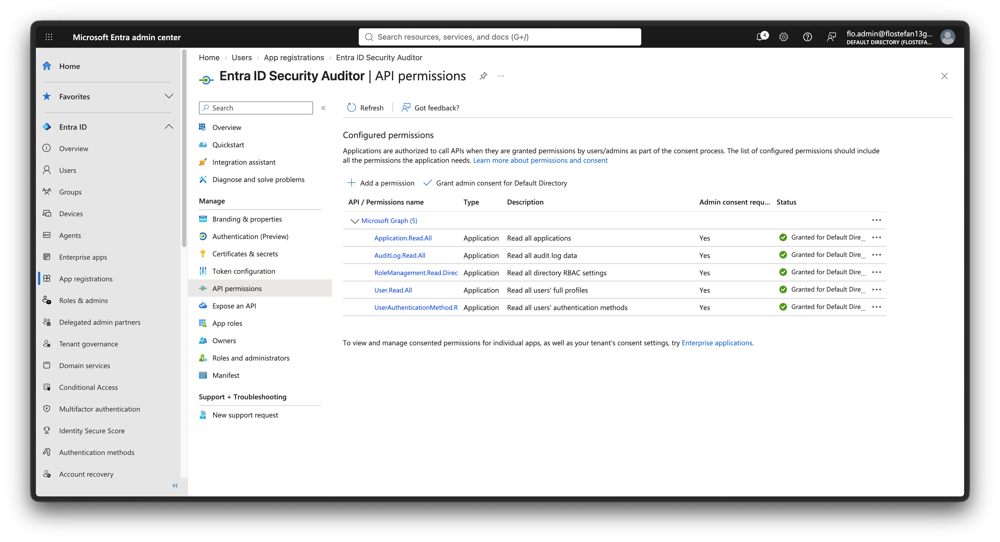
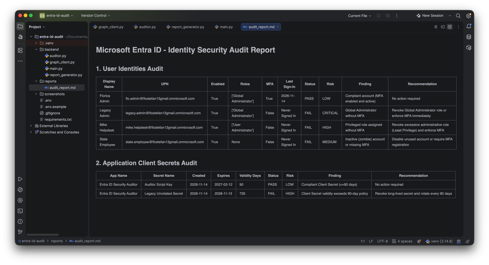
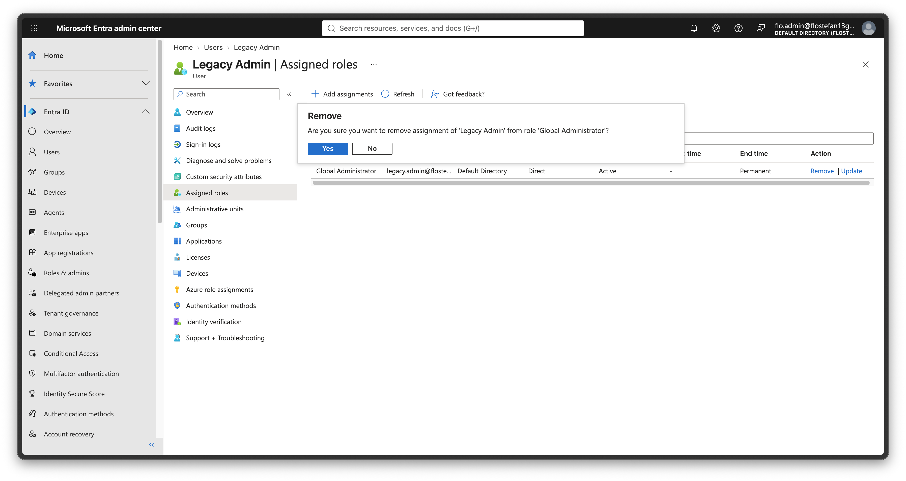
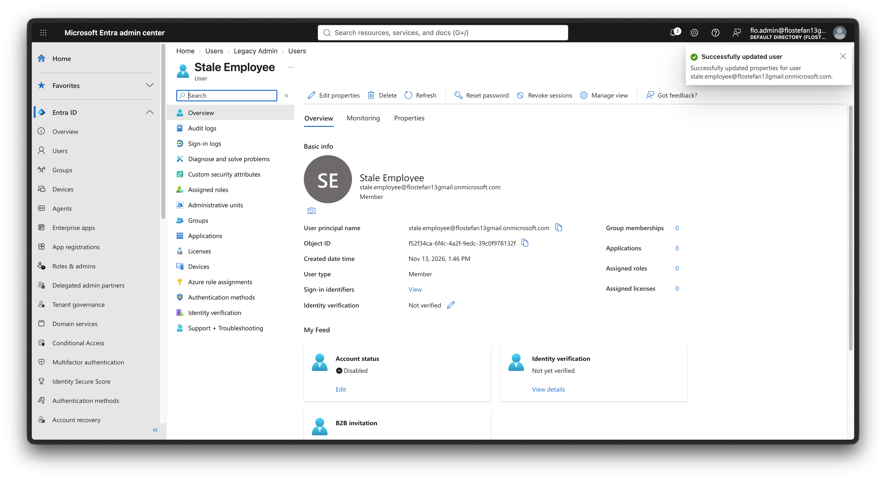
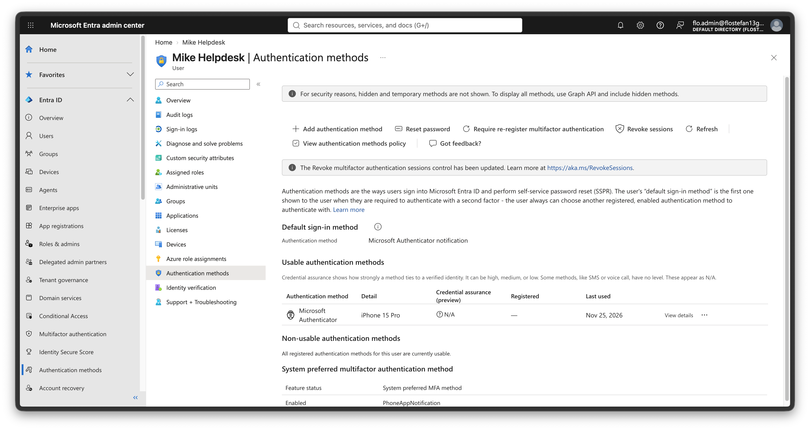
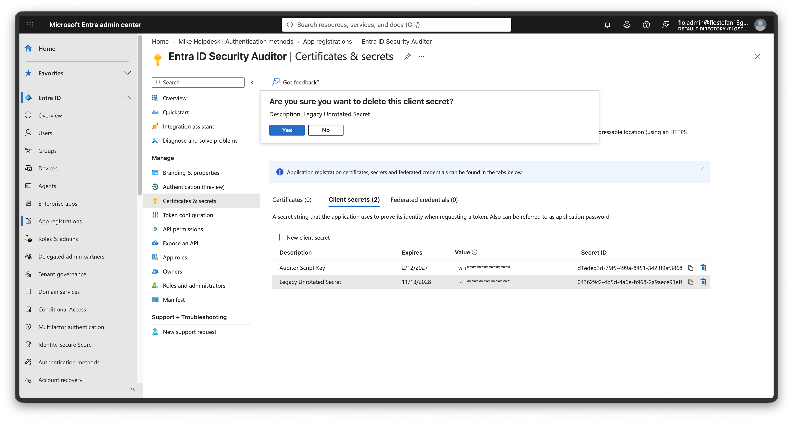
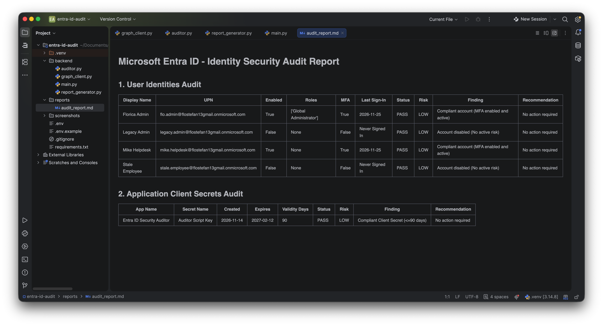

# Microsoft Entra ID — Cloud Identity & Access Misconfiguration Scanner

An automated Cloud Identity and Access Management (IAM) security scanner written in Python that audits a **Microsoft Entra ID** tenant via the **Microsoft Graph API** and **MSAL (OAuth 2.0)**. The scanner detects common identity and credential misconfigurations based on **Microsoft SC-900** and **Zero Trust** principles (*Verify Explicitly*, *Use Least Privileged Access*, *Assume Breach*).

---

## Overview

In cloud environments, identity is the primary security perimeter. Misconfigured directory roles, missing Multi-Factor Authentication (MFA), stale ("zombie") accounts, and unrotated application client secrets represent some of the most common attack vectors for tenant compromise.

This project automates the detection and reporting of four core IAM security controls across a live Microsoft Entra ID tenant:

1. **Privileged Access & MFA Enforcement:** Identifies accounts holding administrative roles (such as `Global Administrator` or `User Administrator`) without registered MFA methods.
2. **Stale / Zombie Account Detection:** Flags active user accounts (`accountEnabled: true`) that have never signed in or have been inactive for more than 90 days by querying real-time sign-in telemetry.
3. **Principle of Least Privilege:** Highlights over-privileged standard/helpdesk accounts and verifies whether disabled accounts still retain residual directory roles.
4. **Application Credential Hygiene:** Audits registered applications (`App Registrations`) to detect expired `Client Secrets` or secrets configured with a validity period exceeding a 90-day rotation policy.

---

## Project Structure

```text
entra-id-audit/
├── backend/
│   ├── graph_client.py       # Authenticates via MSAL and queries Microsoft Graph v1.0 endpoints
│   ├── auditor.py            # Evaluates users, roles, MFA, sign-in logs, and app client secrets
│   ├── report_generator.py   # Generates the structured Markdown audit report
│   └── main.py               # Orchestrates the end-to-end audit pipeline
├── reports/
│   └── audit_report.md       # Generated PASS/FAIL security audit report
├── screenshots/              # Visual evidence of initial setup, findings, and remediation
├── .env.example              # Template for required Entra ID App Registration credentials
└── requirements.txt          # Python dependencies (msal, requests, python-dotenv)
```

---

## Lab Environment & Initial Audit ("Before Remediation")

### 1. Tenant Identities Setup
A dedicated Microsoft Entra ID tenant was configured with both compliant and intentionally misconfigured identities to validate the scanner:
- **`Florica Admin`** — Cloud-native `Global Administrator` with Microsoft Authenticator MFA enrolled and recent sign-in activity (baseline compliant account).
- **`Legacy Admin`** — Unmonitored account assigned `Global Administrator` without MFA.
- **`Mike Helpdesk`** — Helpdesk employee over-privileged with the `User Administrator` role and no MFA registered.
- **`Stale Employee`** — Active employee account (`Enabled`) with no sign-in activity ("zombie" account).



### 2. Least-Privilege API Permissions
The scanner authenticates as a dedicated App Registration (**`Entra ID Security Auditor`**) configured strictly with **Read-Only** Microsoft Graph Application permissions (`User.Read.All`, `RoleManagement.Read.Directory`, `UserAuthenticationMethod.Read.All`, `AuditLog.Read.All`, `Application.Read.All`):



### 3. Initial Audit Report (Before Remediation)
Running `python backend/main.py` against the initial tenant state accurately flagged all three misconfigured user accounts and the 730-day unrotated application client secret (`Legacy Unrotated Secret`):



---

## Security Remediation & Verification ("After Remediation")

Based on the recommendations generated in the initial report, four remediation actions were executed in Microsoft Entra ID:

### 1. Revoking Excessive Global Administrator Privileges (`Legacy Admin`)
Removed the permanent `Global Administrator` role assignment from `Legacy Admin` and disabled the unused legacy account:



### 2. Disabling Stale / Zombie Accounts (`Stale Employee`)
Blocked interactive and non-interactive sign-ins for the unused `Stale Employee` identity by setting `Account enabled` to disabled while preserving audit history:



### 3. Enforcing Least Privilege & MFA Onboarding (`Mike Helpdesk`)
Revoked the excessive `User Administrator` role from `Mike Helpdesk` and completed interactive onboarding with **Microsoft Authenticator** MFA:



### 4. Rotating Non-Compliant Application Client Secrets
Deleted the long-lived `Legacy Unrotated Secret` (730-day validity), retaining only the policy-compliant 90-day credential:



### 5. Post-Remediation Audit Report
Re-running the scanner confirmed that all identities and application credentials now pass the security baseline (`PASS` / `LOW` risk):



---

## Key Technical Learnings

- **Real-Time Sign-In Telemetry (`/auditLogs/signIns`) vs. Cached `signInActivity`:** The summary `signInActivity` property on the `/users` Graph endpoint is updated asynchronously by Microsoft via background batch processing and can lag behind actual user logins by several hours. To ensure accurate, real-time detection after user onboarding, `graph_client.py` queries `/auditLogs/signIns?$filter=userId eq '<id>'&$top=1` directly.
- **MFA Method Enumeration:** Every Entra ID user possesses a default `#microsoft.graph.passwordAuthenticationMethod`. True MFA enrollment is verified by inspecting `/users/{id}/authentication/methods` for additional strong authentication methods (such as Microsoft Authenticator).
- **Least-Privilege Automation:** Auditing tools should never require write permissions unless performing automated remediation. Scoping the App Registration strictly to `*.Read.*` permissions minimizes blast radius if scanner credentials are ever exposed.

---

## Prerequisites & Setup

### Prerequisites
- Python 3.10+
- A Microsoft Entra ID tenant
- An App Registration with the 5 Read-Only Microsoft Graph Application permissions listed above (with Admin Consent granted)

### Installation & Usage

1. **Create and activate a virtual environment:**
   ```bash
   python3 -m venv .venv
   source .venv/bin/activate
   ```

2. **Install dependencies:**
   ```bash
   pip install -r requirements.txt
   ```

3. **Configure environment variables:**
   Copy `.env.example` to `.env` and populate your Entra ID App Registration details:
   ```ini
   TENANT_ID=your_directory_tenant_id
   CLIENT_ID=your_application_client_id
   CLIENT_SECRET=your_client_secret_value
   ```

4. **Run the scanner:**
   ```bash
   python backend/main.py
   ```

5. **Review the report:**
   Open `reports/audit_report.md` to inspect the generated audit tables.
